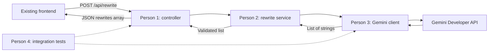

# SayLess backend plan — four-person implementation

**Plan version:** 1.0 · **Prepared:** October 10, 2026 · **Repository baseline:** `97f1ca7` on `main`

**Status:** Planning only. The backend features, tests, packaging, and deployment described here are work to implement, not completed work.

## Start here

All four people are now assigned to the backend effort. These assignments supersede the earlier person-number assignments in the PRD and frontend documents for this phase only. Existing frontend behavior remains the integration baseline.

Every person and their coding agent must read this document and [the shared contract](backend/contract.md), then their individual brief. Give the agent the actual files, not a summary copied into chat. The repository documents and committed interfaces are the handoff mechanism across agents; one agent's chat history is not available to the others.

| Person | Responsibility | Implementation brief |
|---|---|---|
| 1 | Shared foundation, HTTP endpoint, error mapping, configuration, CORS and build setup | [Person 1](backend/person-1-platform-api.md) |
| 2 | Rewrite service, input rules, output validation and service tests | [Person 2](backend/person-2-rewrite-service.md) |
| 3 | Gemini REST client, prompt, structured output parsing and provider tests | [Person 3](backend/person-3-gemini.md) |
| 4 | Integration tests, frontend connection, packaging verification and release coordination | [Person 4](backend/person-4-integration.md) |

Also read [Gemini specification](backend/gemini.md), [integration and acceptance runbook](backend/integration.md), and [decisions and handoff records](backend/decisions.md) where relevant. Person 1 owns shared contract changes; Person 4 owns the integration record.

## What the repository already contains

| Existing files | Finding and consequence for backend work |
|---|---|
| `SayLess_PRD.md` | MVP is message + tone → three distinct, intent-preserving rewrites. No accounts, database, history, uploads or chat. |
| `backend/pom.xml` | Spring Boot **4.1.1**, Java target **21**, MVC/validation starters and their test starters. Retain these versions unless a demonstrated build problem requires a coordinated change. |
| `backend/mvnw`, `mvnw.cmd`, `.mvn/wrapper/maven-wrapper.properties`, `.gitattributes` | Maven wrapper already exists; distribution is 3.10.0. Use the wrapper and retain its platform support. |
| `backend/src/main/java/com/sayless/SaylessBackendApplication.java` | Only application bootstrap exists; keep package root `com.sayless`. There are no controllers, services or provider clients yet. |
| `backend/src/main/resources/application.properties` | Only application name exists. Configuration keys below must be added once, by Person 1. |
| `backend/src/test/java/com/sayless/SaylessBackendApplicationTests.java` | Only a context-load smoke test exists. This does not verify an endpoint or Gemini. |
| `frontend/index.html`, `script.js` | Form is complete; explicit `mock` mode; configurable endpoint; four lowercase tones; JSON POST path already implemented; 30-second browser timeout. |
| `frontend/output.js`, `styles.css` | Three strings are rendered safely; loading/errors/copy/responsive styling exist. Preserve the module's public functions and layout. |
| `frontend/mock-response.js`, `dev-output.html`, `dev-output.js` | Fixed development sample and preview. Keep these visibly separate from live AI generation. |
| `frontend/tests/output-tests.html`, `output-tests.js` | Existing 17-group browser regression suite. Keep it passing and run it during integration. |
| `docs/frontend-plan.md`, `person 4 tasks.md`, `person-3-handoff.md`, `person-4-handoff.md` | Historical frontend implementation and verification details. Earlier assignments of backend to only Persons 1–2 no longer apply. |
| `README.md` | Placeholder; Person 4 will replace it with tested run instructions. |
| `backend/.gitignore` and tracked `backend/target/**` | Build outputs are ignored but **already tracked**, including class files, JARs and reports. Person 1 removes them from the Git index in a dedicated cleanup change; do not remove source or rewrite history. |

No applicable `AGENTS.md`, root `.gitignore`, CI workflow, container configuration, Node package manifest, or provider SDK was found in this baseline. Reinspect at implementation time. The local Java executable was 25, while the project target is 21; use Java 21 for the agreed clean-build gate rather than relying on one developer's installed JDK.

## Architecture and fixed decisions

Use synchronous Spring MVC, constructor injection, Java records for DTOs, one service implementation, and one enabled provider bean. Use the JDK HTTP client for Gemini and the JSON library managed by Spring Boot. Do not introduce a provider SDK, WebFlux, Lombok, database, message queue, framework migration, streaming response, or a second rewrite endpoint.

The user selected **the free Gemini API**. Use the Gemini Developer API, with the model and wire format fixed in [gemini.md](backend/gemini.md). Automated tests use in-memory doubles or local HTTP fixtures and require no key. Only the coordinated live checks contact Gemini. No automatic retries, paid-tier switch, model fallback, or sample-output fallback.

The final demo uses **same-origin serving**: Spring Boot serves the existing frontend from its packaged resources and the browser posts to `/api/rewrite`. Person 1 configures build-time copying of the five runtime frontend files; source remains in `frontend/`. CORS also supports the documented separate-server development workflow.

## Exclusive file ownership

All paths below are repository-relative. New Java production files live under `backend/src/main/java/com/sayless/`; Java tests under `backend/src/test/java/com/sayless/`. Ownership of a directory includes new helper classes in it, except explicitly assigned shared interfaces.

| Owner | Files/directories owned |
|---|---|
| Person 1 | `contract/**` (all shared types below), `api/**`, `config/**`; tests in `api/**`, `config/**`; `backend/pom.xml`; `backend/src/main/resources/application.properties`; `backend/.gitignore`; new root `.gitignore`; `backend/.env.example`; wrapper/bootstrap only if a demonstrated foundation issue requires it; tracked `backend/target/**` index cleanup |
| Person 2 | `service/**`; tests in `service/**` |
| Person 3 | `provider/**`; `backend/src/main/resources/prompts/rewrite-system.txt`; tests in `provider/**`; fixtures in `backend/src/test/resources/gemini/**` |
| Person 4 | tests in `integration/**`; existing `SaylessBackendApplicationTests.java`; `frontend/index.html` and `script.js` for narrowly scoped live integration; `frontend/tests/input-tests.html` and `input-tests.js` if needed; `README.md`; new `.github/workflows/backend.yml` |
| Documentation | Each person owns their new `docs/backend/handoff-person-N.md`. Person 1 maintains `contract.md` and the shared ownership table. Person 3 maintains `gemini.md`. Person 4 maintains `integration.md` and `decisions.md`. Changes to another person's brief go through its owner. |

`frontend/output.js`, `styles.css`, existing output tests, and preview files need no planned edits. If integration finds a defect there, Person 4 records and coordinates one focused fix. Nobody copies the frontend into checked-in Java resources or creates duplicate versions of teammates' files.

## Shared foundation before parallel implementation

Person 1 first delivers a small foundation change containing **only** the shared Java types/signatures from `contract.md`, configuration types/defaults, disabled-provider bean, build-resource mapping, and ignore/index cleanup. It must compile and pass the existing context test without a Gemini key. Do not add the controller until the service is available, and do not add empty service/client implementations that return sample rewrites.

Person 4 records the foundation commit in `decisions.md`. Everyone branches from or incorporates that exact commit. Person 2 can test with a recording `AiRewriteClient` double; Person 3 can test against a local HTTP fixture server; Person 1 can write MVC tests with a mocked `RewriteService`; Person 4 can prepare the integrated test matrix. Shared types come from the foundation, never re-created in each branch.

## Work sequence and merge gates

| Phase | Person 1 | Person 2 | Person 3 | Person 4 | Exit gate |
|---|---|---|---|---|---|
| 0: preparation | Inspect JDK/build, publish foundation | Read contract, prepare validation cases | Verify model/free-tier access and provider specification | Record baseline, prepare test cases and branches | Foundation commit identified; shared signatures compile |
| 1: parallel implementation | Controller, advice, CORS/MVC tests | Service and isolated tests | Client, prompt and local-server tests | Integration tests, CI and runbook preparation | Each owner's isolated tests pass; no invented alternate contracts |
| 2: combine | Merge shared config fixes | Merge service | Merge Gemini adapter | Combine branches; run full suite with no live key | Clean build, disabled-mode boot and local-provider integration pass |
| 3: live connection | Resolve API/config defects | Review validation/quality failures | Run one real Gemini probe, then support live matrix | Switch frontend to API, test packaged app and CORS | Real rewrites, copy and failure recovery demonstrated |
| 4: release | Review contract compliance | Review service behavior | Record provider/model/quota evidence | Final clean checkout test, handoffs and merge review | Acceptance checklist complete; outstanding limits clearly recorded |

Suggested planning budget is 30–45 minutes for foundation, 2–3 hours in parallel, then 1–2 hours for integration/demo checks. These are estimates, not a claim about remaining hackathon time. If time is tight, keep the same gates and omit optional polish.

## Branch and agent coordination rules

Suggested branches: `backend/foundation`, `backend/p1-api`, `backend/p2-service`, `backend/p3-gemini`, `backend/p4-integration`. Person 4 is the integration coordinator. Use separate clones/worktrees if agents run simultaneously on one machine. Never have multiple agents changing branches or writing the same checkout at once.

1. Start by reading the current files, `git status`, this plan, the contract, the person's brief, and any newly added repository instructions.
2. Report unexpected existing edits and preserve them. Work only in assigned files. A missing teammate implementation is a dependency, not permission to replace it.
3. Propose a shared-interface/config change in `decisions.md` through its owner: old/new behavior, reason, affected files, required test changes. Person 1 updates the contract and foundation types together; all affected owners acknowledge and incorporate that commit before using the changed interface.
4. Keep fixture/mock beans inside tests. The only production non-live bean is the explicit disabled provider, which returns an unavailable error.
5. Use targeted test commands on incomplete feature branches. Before integration, it is expected that a controller-only branch lacks a real service bean. Do not fix this by adding a duplicate production service. Full application tests become mandatory after dependency branches are combined.
6. Merge in this order: foundation → service → provider → controller/API → integration/frontend. Integration test code may be prepared earlier. Run the complete suite after the combined merge and again only when subsequent changes warrant it.
7. Stage named paths. Do not commit secrets, build output, local IDE state, screenshots with personal messages, or teammates' unrelated edits. Never resolve conflicts using a blanket “ours” or “theirs.”
8. Each person supplies their handoff record before merge; Person 4 checks the actual diff against ownership and the frozen contract. Commit/push/merge actions follow the team's explicit instructions; this planning request does not perform them.

## Definition of done

“All four branches compile” is insufficient. Done means the same packaged app accepts the existing frontend request, returns three valid Gemini rewrites in the chosen tone, preserves intent in the manual matrix, handles invalid input/provider failure without leaking internals, and supports copying/retry. Tests must cover boundaries between the owners, not just individual methods.

Use the detailed [acceptance matrix and commands](backend/integration.md). A green test suite with mocked responses means **integration logic verified**; it does not mean **live Gemini verified**. No document should promise perfect model output or conflict-free merges: the contracts and gates make disagreements visible before release.

## Toolchain reference for implementing agents

Spring Boot 4 changed module names and defaults to Jackson 3; do not copy older Boot 2/3 imports or add Jackson 2 to make a tutorial compile. Check the resolved dependency tree for this checkout. The Boot 4 migration guide explains these changes, and the MVC testing reference describes slice-test boundaries. [Spring Boot migration guide](https://github.com/spring-projects/spring-boot/wiki/Spring-Boot-4.0-Migration-Guide), [MVC testing reference](https://docs.spring.io/spring-boot/reference/testing/spring-boot-applications.html).
